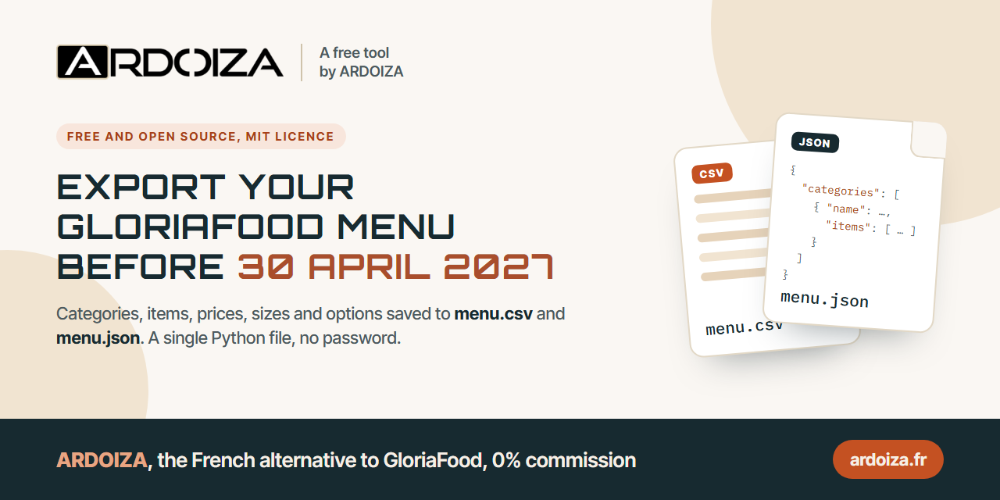
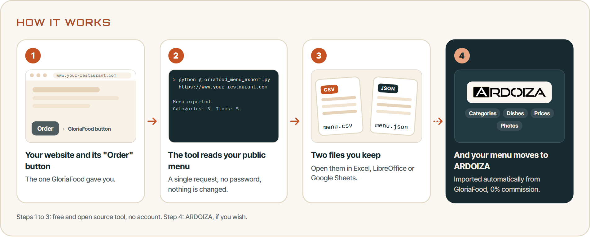
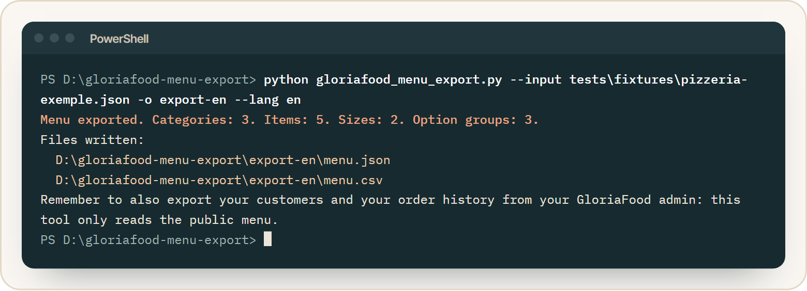
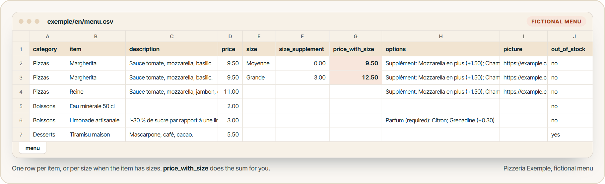
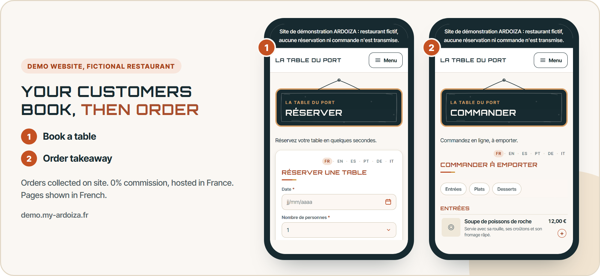

<p align="center"></p>

# Export your GloriaFood menu before the 30 April 2027 shutdown

**gloriafood-menu-export** saves your GloriaFood menu (categories, items, descriptions, prices, sizes, options and photo links) into two files you keep: `menu.json` and `menu.csv`, which opens in Excel, LibreOffice or Google Sheets.

A single Python file, nothing else to install, no password needed. MIT licence, free and open source.

> GloriaFood shuts down on 30 April 2027 (GloriaFood end of life). Export your menu while it is still online.

[Version française](README.md)

> **Looking for a GloriaFood alternative?** ARDOIZA imports your menu automatically, 30-day free trial with no bank card needed.<br>
> **[Discover the GloriaFood alternative →](https://www.ardoiza.fr/en/gloriafood-alternative/?utm_source=github&utm_medium=readme&utm_campaign=gloriafood-menu-export&utm_content=encart-en&src=github)**

## Contents

- [GloriaFood shutdown: what has been announced](#gloriafood-shutdown-what-has-been-announced)
- [Why export your menu before the shutdown](#why-export-your-menu-before-the-shutdown)
- [What the tool exports, and what it does not](#what-the-tool-exports-and-what-it-does-not)
- [Installation](#installation)
- [Usage](#usage)
- [The output](#the-output)
- [Safety and fair use](#safety-and-fair-use)
- [FAQ](#faq)
- [What next? A GloriaFood alternative](#what-next-a-gloriafood-alternative)

## GloriaFood shutdown: what has been announced

Oracle, the publisher of GloriaFood, released an FAQ in March 2026: "Oracle GloriaFood EOL Frequently Asked Questions", version 1.0 ([Oracle PDF](https://www.oracle.com/webfolder/dms/prod/d3/FAQs-GL.pdf)). EOL stands for end of life. The document states that:

- all GloriaFood products and services, and the partner program, reach end of life on **30 April 2027**;
- a paid service ends on the expiration date of its subscription renewal, between 1 and 30 April 2027, unless terminated earlier;
- following expiration, termination or cancellation of a service, the restaurant may retrieve its data for **30 days**.

The [gloriafood.com](https://www.gloriafood.com/) banner shows the same date: "GloriaFood will reach end of life on April 30, 2027."

## Why export your menu before the shutdown

- **Once the service stops, the menu goes.** This tool reads the public menu, the one your customers see behind the "Order" button. After the shutdown, you cannot count on it any more.
- **Thirty days is short.** The data retrieval period starts when your service ends, and a paid service can end before 30 April 2027.
- **A menu takes hours to type.** A real menu tried while building this tool had 106 items, 58 sizes and 165 option groups. Typing that again by hand means whole evenings and pricing mistakes.
- **The file is yours.** Keep it, print it, check it, hand it to whichever tool comes next.
- **Photos too.** The file keeps each photo's address, but the photos stay hosted by GloriaFood: save the ones you want before the shutdown.

## What the tool exports, and what it does not

It exports, in your menu order:

- categories and their description;
- items: name, description, price, out of stock flag;
- sizes (for example Medium, Large) with their supplement and the total price;
- option groups (extras, required choices) with the price of each choice;
- each item's photo address;
- the menu currency.

It does not export:

- **your customers**: in the GloriaFood admin, open the reports ("Reports"), the list view ("List view"), then the customer list ("Clients"), and export it as CSV;
- **your order history**, opening hours, promotions, payment and delivery settings: write them down or export them from your GloriaFood admin.

The tool reads the menu as your customers see it: an item you switched off may not be in it.

## Installation

1. You need Python 3.8 or later (tested with Python 3.13). On Windows, install it from [python.org](https://www.python.org/downloads/) and tick "Add Python to PATH". On macOS and Linux it is often already there: type `python3 --version` to check.
2. Download [`gloriafood_menu_export.py`](gloriafood_menu_export.py), or the whole folder with "Code" then "Download ZIP".

Nothing else to install: the tool only uses the Python standard library.

## Usage

<p align="center"></p>

Open a terminal (on Windows: Windows key, type "PowerShell") in the folder that holds the file.

### With your website address

```bash
python gloriafood_menu_export.py https://www.your-restaurant.com --lang en
```

Give the address of the page that shows your "Order" or "Book" button. The tool finds your GloriaFood restaurant ID there, then reads your menu.

### With your restaurant ID

If your button is on another page, or the tool cannot find it, give your ID directly. It is the `data-glf-ruid` value in the button code supplied by GloriaFood:

```html
<span class="glf-button" data-glf-cuid="..." data-glf-ruid="11111111-2222-4333-8444-555555555555">Order</span>
```

```bash
python gloriafood_menu_export.py 11111111-2222-4333-8444-555555555555 --lang en
```

### Offline, from a saved response

```bash
python gloriafood_menu_export.py --input menu-gloriafood-brut.json --lang en
```

### Options

| Option | Purpose |
|---|---|
| `-o FOLDER`, `--output FOLDER` | folder for the files (default: `export-gloriafood`) |
| `--lang en` | English messages and CSV columns, comma separator and decimal point (default: French) |
| `--raw` | also keep GloriaFood's full response (`menu-gloriafood-brut.json`) |
| `--input FILE` | convert a saved response, without any request |
| `--timeout SECONDS` | timeout per request (default: 20) |
| `--force` | overwrite existing files (otherwise the tool refuses) |

On macOS and Linux, use `python3` instead of `python` if needed.

## The output

Full example from a **fictional** menu ("Pizzeria Exemple"): folder [`exemple/en/`](exemple/en/).

<p align="center"></p>

<p align="center"></p>

`menu.csv` (one row per item, or one row per size when the item has sizes):

```text
category,item,description,price,size,size_supplement,price_with_size,options,picture,out_of_stock
Pizzas,Margherita,"Sauce tomate, mozzarella, basilic.",9.50,Moyenne,0.00,9.50,Supplément: Mozzarella en plus (+1.50); Champignons (+1.00),https://example.com/photos/margherita.jpg,no
Pizzas,Margherita,"Sauce tomate, mozzarella, basilic.",9.50,Grande,3.00,12.50,Supplément: Mozzarella en plus (+1.50); Champignons (+1.00) | Bord: Bord fromage (+2.00),https://example.com/photos/margherita.jpg,no
Boissons,Limonade artisanale,'-30 % de sucre par rapport à une limonade classique.,3.00,,,,Parfum (required): Citron; Grenadine (+0.30),,no
Desserts,Tiramisu maison,"Mascarpone, café, cacao.",5.50,,,,,,yes
```

Good to know:

- GloriaFood stores a size price as a supplement added to the item price; the tool does the sum in `price_with_size`.
- The file is UTF-8 with the byte order mark that lets Excel show accents. Comma separator and decimal point with `--lang en`; semicolon and decimal comma in French.
- A cell starting with `=`, `+`, `@` or a `-` stuck to text gets an apostrophe in front, so that a spreadsheet does not run it as a formula. `menu.json` keeps the original text.

`menu.json` keeps the whole structure (categories, items, sizes, option groups, choices, prices as numbers) in a stable format, `gloriafood-menu-export/1`, easy for another program to read.

Exit codes, handy in scripts: `0` success, `1` input not recognised, `2` menu not found (404 or no button on the page), `3` network error or timeout, `4` unreadable response, `5` files already there or cannot write.

## Safety and fair use

- **Use it for your own menu**, or for a restaurant that asked you to. The menu belongs to the restaurant.
- **Read only.** No login, no password, nothing changed on GloriaFood's side.
- **One request per menu.** If you give your website address, the tool first reads that page, then makes a single request for the menu. No loops, no bulk scraping. It identifies itself honestly: `gloriafood-menu-export/1.0.0 (+https://github.com/robibi14/gloriafood-menu-export)`.
- **Careful with what it receives.** Response size capped, redirects limited to http and https, ID checked before use, no file overwritten without `--force`.
- **Readable.** One file, no dependency, which you can read before running it.
- **Independent tool**, not affiliated with Oracle. GloriaFood is a trademark of Oracle. The address it reads is the one used by the public ordering button: Oracle does not document it, and it may change or stop answering before 30 April 2027.

## FAQ

**Do I need a GloriaFood login?**
No. The tool reads the public menu, the same one your "Order" button shows.

**The tool cannot find my button.**
The button may be on another page of your website ("Order", "Menu", "Book"): give the address of that page, or your restaurant ID directly (see above).

**I get a 404 error.**
No menu answers for this ID: the GloriaFood account is probably closed or deleted, or the ID has a typo. That is exactly why it is better to export before the shutdown.

**I run several restaurants.**
Run the tool once per ID, with a different folder for each: `-o restaurant-1`, `-o restaurant-2`.

**Can I import this file into another tool?**
The CSV opens anywhere and the JSON follows a documented format. Each tool has its own way of importing a menu: check with it.

**How do I run the tests?**

```bash
python -m unittest discover -s tests -v
```

The tests use no network: they run on the fictional menu in `tests/fixtures/`.

## What next? A GloriaFood alternative

Your menu is safe. What is left is replacing the "Book" and "Order" buttons on your website before 30 April 2027.

<p align="center"></p>

This tool is published by the team behind **ARDOIZA**, a French table booking and takeaway ordering service for restaurants. If you are looking for a GloriaFood alternative:

- **0% commission** on your bookings and orders: a fixed monthly subscription;
- **table booking, then takeaway ordering**, collected on site (ARDOIZA does not do delivery);
- **your GloriaFood menu imported automatically**: categories, dishes, prices and photos;
- three plans: **Basic €29 a month** (you already have a website, whatever it is built with), **Essentiel €40 a month** (ARDOIZA builds your full website), **Pro €89 a month** (three venues included); no commitment, VAT not applicable, art. 293 B of the French General Tax Code;
- **30-day free trial, no bank card needed**;
- **hosted in France**;
- sign-up open to businesses registered in France (SIRET number required).

Learn more: [the GloriaFood alternative](https://www.ardoiza.fr/en/gloriafood-alternative/?utm_source=github&utm_medium=readme&utm_campaign=gloriafood-menu-export&utm_content=en&src=github) and [migrating from GloriaFood, step by step](https://www.ardoiza.fr/en/migrate-from-gloriafood/?utm_source=github&utm_medium=readme&utm_campaign=gloriafood-menu-export&utm_content=en&src=github).

<p align="center"><a href="https://app.ardoiza.fr/inscription?lang=en&utm_source=github&utm_medium=readme&utm_campaign=gloriafood-menu-export&utm_content=bouton-essai-en&src=github"></a></p>

See it all in pictures (demo website, app, plans): [github.com/robibi14/gloriafood-alternative](https://github.com/robibi14/gloriafood-alternative).

## Licence

[MIT](LICENSE), copyright 2026 ARDOIZA. You may use, copy, modify and redistribute this tool freely, including for commercial use.

Found a bug, or a menu that exports badly? Open an issue describing the problem, without pasting your restaurant's data.
