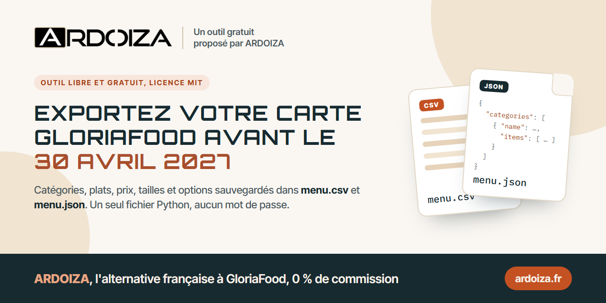
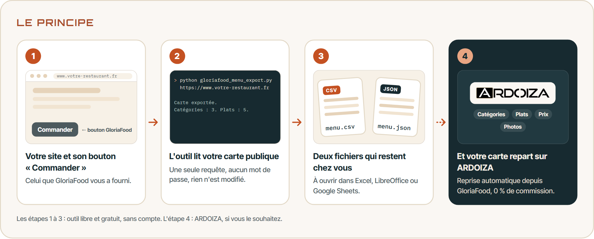
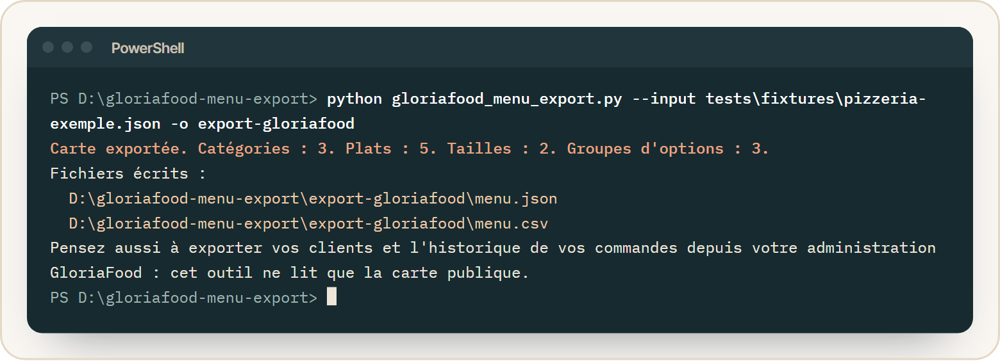
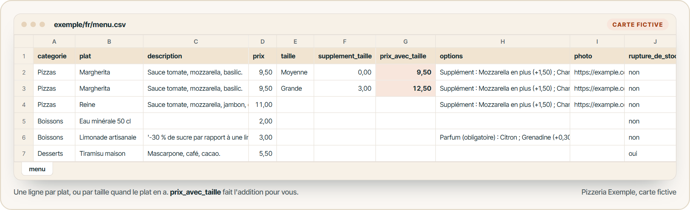
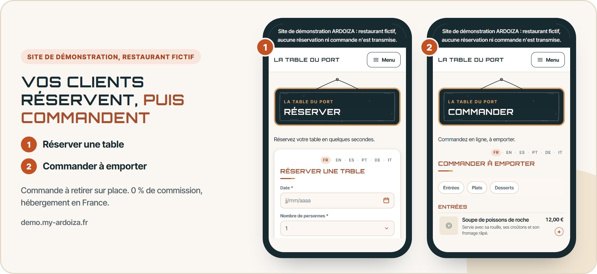

<p align="center"></p>

# Exporter sa carte GloriaFood avant l'arrêt du 30 avril 2027

**gloriafood-menu-export** sauvegarde votre carte GloriaFood (catégories, plats, descriptions, prix, tailles, options et liens des photos) dans deux fichiers qui restent chez vous : `menu.json` et `menu.csv`, que l'on ouvre avec Excel, LibreOffice ou Google Sheets.

Un seul fichier Python, rien à installer en plus, aucun mot de passe demandé. Licence MIT, libre et gratuit.

> GloriaFood s'arrête le 30 avril 2027 (en anglais : *GloriaFood shutdown*, *GloriaFood end of life*). Exportez votre carte tant qu'elle est encore en ligne.

[English version](README.en.md)

> **Vous cherchez une alternative à GloriaFood ?** ARDOIZA reprend votre carte automatiquement, essai 30 jours sans carte bancaire.<br>
> **[Découvrir l'alternative à GloriaFood →](https://www.ardoiza.fr/alternative-gloriafood/?utm_source=github&utm_medium=readme&utm_campaign=gloriafood-menu-export&utm_content=encart&src=github)**

## Sommaire

- [Fin de GloriaFood : ce qui est annoncé](#fin-de-gloriafood--ce-qui-est-annoncé)
- [Pourquoi exporter votre carte avant l'arrêt](#pourquoi-exporter-votre-carte-avant-larrêt)
- [Ce que l'outil exporte, et ce qu'il n'exporte pas](#ce-que-loutil-exporte-et-ce-quil-nexporte-pas)
- [Installation](#installation)
- [Utilisation](#utilisation)
- [Le résultat](#le-résultat)
- [Sécurité et bonne conduite](#sécurité-et-bonne-conduite)
- [Questions fréquentes](#questions-fréquentes)
- [Et après ? Une alternative à GloriaFood](#et-après--une-alternative-à-gloriafood)

## Fin de GloriaFood : ce qui est annoncé

Oracle, l'éditeur de GloriaFood, a publié en mars 2026 une foire aux questions : « Oracle GloriaFood EOL Frequently Asked Questions », version 1.0 ([document PDF d'Oracle](https://www.oracle.com/webfolder/dms/prod/d3/FAQs-GL.pdf)). EOL signifie *end of life*, fin de vie du produit. Ce que dit ce document :

- tous les produits et services GloriaFood, ainsi que le programme partenaires, s'arrêtent le **30 avril 2027** ;
- un service payant prend fin à la date d'échéance de son renouvellement, entre le 1er et le 30 avril 2027, sauf résiliation plus tôt ;
- après l'expiration, la résiliation ou l'annulation d'un service, le restaurant dispose de **30 jours** pour récupérer ses données.

Le site [gloriafood.com](https://www.gloriafood.com/) affiche la même date dans son bandeau : « GloriaFood will reach end of life on April 30, 2027. »

## Pourquoi exporter votre carte avant l'arrêt

- **Après l'arrêt, la carte disparaît.** C'est la carte publique, celle que vos clients voient derrière le bouton « Commander », que lit cet outil. Une fois le service arrêté, il ne faut plus compter dessus.
- **Trente jours, c'est court.** Le délai de récupération des données commence dès la fin de votre service, et un service payant peut s'arrêter avant le 30 avril 2027.
- **Une carte représente des heures de saisie.** Une carte réelle essayée pendant la mise au point de l'outil comptait 106 plats, 58 tailles et 165 groupes d'options. La ressaisir à la main, c'est des soirées entières et des erreurs de prix.
- **Le fichier vous appartient.** Vous le gardez, vous l'imprimez, vous le relisez, vous le donnez au prochain outil, quel qu'il soit.
- **Les photos aussi.** Le fichier garde l'adresse de chaque photo, mais les photos restent hébergées chez GloriaFood : enregistrez celles que vous voulez garder avant l'arrêt.

## Ce que l'outil exporte, et ce qu'il n'exporte pas

Il exporte, dans l'ordre de votre carte :

- les catégories et leur description ;
- les plats : nom, description, prix, indication de rupture de stock ;
- les tailles (par exemple Moyenne, Grande) avec leur supplément et le prix total ;
- les groupes d'options (suppléments, choix obligatoires) avec le prix de chaque choix ;
- l'adresse de la photo de chaque plat ;
- la devise de la carte.

Il n'exporte pas :

- **vos clients** : dans l'administration GloriaFood, ouvrez les rapports (« Reports »), la vue en liste (« List view »), puis la liste des clients (« Clients »), et exportez-la au format CSV ;
- **l'historique de vos commandes**, vos horaires, vos promotions, vos réglages de paiement et de livraison : notez-les ou exportez-les depuis votre administration GloriaFood.

L'outil lit la carte telle que vos clients la voient : un plat que vous avez désactivé peut ne pas y figurer.

## Installation

1. Il faut Python 3.8 ou plus récent (outil essayé avec Python 3.13). Sur Windows, installez-le depuis [python.org](https://www.python.org/downloads/) en cochant « Add Python to PATH ». Sur macOS et Linux, il est souvent déjà présent : tapez `python3 --version` pour le savoir.
2. Téléchargez le fichier [`gloriafood_menu_export.py`](gloriafood_menu_export.py), ou tout le dossier avec le bouton « Code » puis « Download ZIP ».

Aucune autre installation : l'outil n'utilise que la bibliothèque standard de Python.

## Utilisation

<p align="center"></p>

Ouvrez un terminal (sur Windows : touche Windows, tapez « PowerShell ») dans le dossier où se trouve le fichier.

### Avec l'adresse de votre site

```bash
python gloriafood_menu_export.py https://www.votre-restaurant.fr
```

Donnez l'adresse de la page où se trouve votre bouton « Commander » ou « Réserver ». L'outil y trouve votre identifiant de restaurant GloriaFood, puis lit votre carte.

### Avec votre identifiant de restaurant

Si votre bouton est sur une autre page, ou si l'outil ne le trouve pas, donnez directement votre identifiant. C'est la valeur `data-glf-ruid` du code du bouton fourni par GloriaFood :

```html
<span class="glf-button" data-glf-cuid="..." data-glf-ruid="11111111-2222-4333-8444-555555555555">Commander</span>
```

```bash
python gloriafood_menu_export.py 11111111-2222-4333-8444-555555555555
```

### Sans réseau, à partir d'une réponse déjà enregistrée

```bash
python gloriafood_menu_export.py --input menu-gloriafood-brut.json
```

### Options

| Option | Rôle |
|---|---|
| `-o DOSSIER`, `--output DOSSIER` | dossier où écrire les fichiers (par défaut : `export-gloriafood`) |
| `--lang en` | messages et colonnes du CSV en anglais, séparateur virgule et point décimal |
| `--raw` | garde aussi la réponse complète de GloriaFood (`menu-gloriafood-brut.json`) |
| `--input FICHIER` | convertit une réponse déjà enregistrée, sans aucune requête |
| `--timeout SECONDES` | délai d'attente par requête (par défaut : 20) |
| `--force` | remplace des fichiers déjà présents (sinon, l'outil refuse de les écraser) |

Sur macOS et Linux, remplacez `python` par `python3` si besoin.

## Le résultat

Exemple complet, tiré d'une carte **fictive** (« Pizzeria Exemple ») : dossier [`exemple/`](exemple/).

<p align="center"></p>

<p align="center"></p>

`menu.csv` (une ligne par plat, ou une ligne par taille quand le plat en a) :

```text
categorie;plat;description;prix;taille;supplement_taille;prix_avec_taille;options;photo;rupture_de_stock
Pizzas;Margherita;Sauce tomate, mozzarella, basilic.;9,50;Moyenne;0,00;9,50;"Supplément : Mozzarella en plus (+1,50) ; Champignons (+1,00)";https://example.com/photos/margherita.jpg;non
Pizzas;Margherita;Sauce tomate, mozzarella, basilic.;9,50;Grande;3,00;12,50;"Supplément : Mozzarella en plus (+1,50) ; Champignons (+1,00) | Bord : Bord fromage (+2,00)";https://example.com/photos/margherita.jpg;non
Boissons;Limonade artisanale;'-30 % de sucre par rapport à une limonade classique.;3,00;;;;"Parfum (obligatoire) : Citron ; Grenadine (+0,30)";;non
Desserts;Tiramisu maison;Mascarpone, café, cacao.;5,50;;;;;;oui
```

Bon à savoir :

- GloriaFood enregistre le prix d'une taille comme un supplément ajouté au prix du plat ; l'outil fait l'addition dans `prix_avec_taille`.
- Le fichier est en UTF-8 avec la marque qui permet à Excel d'afficher les accents. Séparateur point-virgule et virgule décimale en français, virgule et point avec `--lang en`.
- Une cellule qui commence par `=`, `+`, `@` ou un `-` collé à du texte reçoit une apostrophe devant elle, pour qu'un tableur ne la prenne pas pour une formule. Le fichier `menu.json` garde le texte d'origine.

`menu.json` garde toute la structure (catégories, plats, tailles, groupes d'options, choix, prix en nombres) dans un format stable, `gloriafood-menu-export/1`, facile à relire par un autre programme.

Codes de sortie, utiles dans un script : `0` réussi, `1` entrée non reconnue, `2` carte introuvable (404 ou aucun bouton sur la page), `3` réseau ou délai dépassé, `4` réponse illisible, `5` fichiers déjà présents ou écriture impossible.

## Sécurité et bonne conduite

- **À utiliser pour votre propre carte**, ou pour celle d'un restaurant qui vous l'a demandé. La carte appartient au restaurant.
- **Lecture seule.** Aucune connexion à votre compte, aucun mot de passe, rien n'est modifié chez GloriaFood.
- **Une seule requête par carte.** Si vous donnez l'adresse de votre site, l'outil lit d'abord cette page, puis fait une seule requête pour la carte. Pas de boucle, pas de collecte en masse. Il se présente honnêtement : `gloriafood-menu-export/1.0.0 (+https://github.com/robibi14/gloriafood-menu-export)`.
- **Prudent avec ce qu'il reçoit.** Réponses limitées en taille, redirections limitées à http et https, identifiant contrôlé avant d'être utilisé, aucun fichier écrasé sans `--force`.
- **Lisible.** Un seul fichier, sans dépendance, que vous pouvez relire avant de le lancer.
- **Outil indépendant**, sans lien avec Oracle. GloriaFood est une marque d'Oracle. L'adresse lue est celle qu'utilise le bouton de commande public : elle n'est pas documentée par Oracle et peut changer ou cesser de répondre avant le 30 avril 2027.

## Questions fréquentes

**Faut-il un compte GloriaFood ou un mot de passe ?**
Non. L'outil lit la carte publique, la même que celle qu'affiche votre bouton « Commander ».

**L'outil ne trouve pas mon bouton.**
Le bouton est peut-être sur une autre page de votre site (« Commander », « Carte », « Réserver ») : donnez l'adresse de cette page, ou directement votre identifiant de restaurant (voir plus haut).

**J'obtiens une erreur 404.**
Aucune carte ne répond pour cet identifiant : le compte GloriaFood est probablement fermé ou supprimé, ou l'identifiant contient une faute. C'est précisément pour cela qu'il vaut mieux exporter avant l'arrêt.

**J'ai plusieurs restaurants.**
Lancez l'outil une fois par identifiant, avec un dossier différent pour chacun : `-o restaurant-1`, `-o restaurant-2`.

**Les accents sont illisibles dans Excel.**
Le fichier est en UTF-8. Si votre version d'Excel l'ouvre mal, passez par « Données », puis « À partir d'un fichier texte », et choisissez l'encodage UTF-8.

**Puis-je réimporter ce fichier dans un autre outil ?**
Le CSV s'ouvre partout et le JSON suit un format documenté. Chaque outil a sa propre façon d'importer une carte : renseignez-vous auprès de lui.

**Comment lancer les tests ?**

```bash
python -m unittest discover -s tests -v
```

Les tests n'utilisent aucun réseau : ils travaillent sur la carte fictive de `tests/fixtures/`.

## Et après ? Une alternative à GloriaFood

Votre carte est à l'abri. Il reste à remplacer les boutons « Réserver » et « Commander » de votre site avant le 30 avril 2027.

<p align="center"></p>

Cet outil est publié par l'équipe d'**ARDOIZA**, un service français de réservation de table et de commande à emporter pour les restaurants. Si vous cherchez une alternative à GloriaFood :

- **0 % de commission** sur vos réservations et vos commandes : un abonnement fixe par mois ;
- **la réservation de table, puis la commande à emporter**, à retirer sur place (ARDOIZA ne fait pas la livraison) ;
- **votre carte GloriaFood reprise automatiquement** : catégories, plats, prix et photos ;
- trois offres : **Basic 29 € par mois** (vous avez déjà un site, quel qu'il soit), **Essentiel 40 € par mois** (ARDOIZA crée votre site complet), **Pro 89 € par mois** (trois établissements compris) ; sans engagement, TVA non applicable, art. 293 B du CGI ;
- **30 jours d'essai, sans carte bancaire** ;
- **hébergement en France** ;
- inscription ouverte aux entreprises immatriculées en France (numéro SIRET demandé).

Pour en savoir plus : [l'alternative à GloriaFood](https://www.ardoiza.fr/alternative-gloriafood/?utm_source=github&utm_medium=readme&utm_campaign=gloriafood-menu-export&utm_content=fr&src=github) et [migrer depuis GloriaFood, étape par étape](https://www.ardoiza.fr/migrer-depuis-gloriafood/?utm_source=github&utm_medium=readme&utm_campaign=gloriafood-menu-export&utm_content=fr&src=github).

<p align="center"><a href="https://app.ardoiza.fr/inscription?utm_source=github&utm_medium=readme&utm_campaign=gloriafood-menu-export&utm_content=bouton-essai&src=github"></a></p>

Pour tout voir en images (captures du site de démonstration, application, offres) : [github.com/robibi14/gloriafood-alternative](https://github.com/robibi14/gloriafood-alternative).

## Licence

[MIT](LICENSE), copyright 2026 ARDOIZA. Vous pouvez utiliser, copier, modifier et redistribuer cet outil librement, y compris pour un usage commercial.

Une erreur, une carte qui s'exporte mal ? Ouvrez une *issue* en décrivant le problème, sans y coller les données de votre restaurant.
